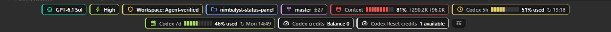

# Status Panel

*A Nimbalyst bottom panel showing model, context usage and plan limits for the session you are talking to.*

Status Panel adds a strip of chips to Nimbalyst's bottom panel that tracks the focused Agent session: its requested model and last observed reply, configured reasoning effort, workspace policy, working folder and git branch, current context and token counters. Usage groups follow the selected provider and explain when its allowance cannot be read. Claude plan usage and host-reported Codex allowances are available. Successful Codex readings use the same usage colors as Claude; their tooltips explain unverified account/session ownership and unknown original observation time.




## What it shows

| Chip | Content |
| --- | --- |
| Model | Catalog name or readable ID; verified served identity when available, with requested and past-reply IDs in the tooltip |
| Effort | Configured effort, e.g. `High`; applicable defaults say `(default)`, and missing values have a placeholder |
| Workspace policy | `Workspace: Ask` / `Allow all` / `Bypass` / `Agent-verified`; separate from provider approval, sandbox and network access |
| Directory | Workspace folder name; the host git channels do not report a repository root |
| Branch | Current branch with `±n` uncommitted files; `±?` when the count is unavailable, `No repo` for a confirmed non-repository, `Git —` when detection fails |
| Context | Reported current occupancy and window; separate token counters remain available even without a percentage |
| Primary / secondary window | The provider's reported windows, with their actual labels, durations and resets; Claude currently reports `5h` / `7d` |
| Additional limits / credits | Other buckets, model caps and reported credits, including limits without a model scope |

Percentage bars show usage used and turn yellow and then red as a limit gets close. Remaining percentages are converted to used, with the source reading explained in the tooltip. Quantities and credit balances have no invented percentage or urgency color. Cached readings retain their last successful observation time and render muted; unknown values never mean zero or unlimited. The screenshots show a real Codex session in both themes. Its successful percentage readings use the normal usage colors; tooltips explain unverified ownership and source age.

## Usage

Open the panel from its icon in the left rail, or toggle it with **Ctrl+Shift+S**. It also appears in the bottom panel group under `Ctrl+J`.

The gear chip at the end of the strip opens a picker for which segments appear and in what order. That choice is stored globally, so it follows you from workspace to workspace instead of resetting per project.

Usage has three stable controls: **Primary window**, **Secondary window**, and **Additional limits / credits**. Their labels explain the current contents. New or renamed buckets stay within these groups without adding duplicate controls. Adapters identify primary and secondary windows; unfamiliar windows remain visible under additional limits. Enabled groups stay visible when reporting is unsupported, sign-in is required, a reading is unavailable, or no window applies.

Existing Claude settings migrate in place: the old 5h control becomes primary, 7d becomes secondary, and model-scoped limits become additional. Each keeps its position and hidden state, including positions between other chips. Startup and update-check settings are preserved. Migration reads do not overwrite storage; the next settings edit saves the new format. Reset explicitly restores defaults.

## Staying up to date

Nimbalyst does not auto-update extensions installed from GitHub, so the panel checks for itself. Every few hours it asks GitHub whether this repo has a newer release, and if one exists an **Update** chip appears at the end of the strip. Clicking it shows what changed and offers to install — never automatically, and never without you pressing the button. The new version runs after you restart Nimbalyst.

Nothing appears while you are up to date, and nothing appears when the check cannot be made: offline, rate-limited, or unable to read the release, the chip simply does not show. It never becomes an error or a spinner.

The check is a setting — **Behavior → Check for updates** in the gear popover, on by default. Turning it off stops the request being made at all, not just the chip being shown. With it off, re-paste the repo URL into **Install from GitHub** to upgrade by hand.

The version you are running is named at the foot of that same popover, and when a newer release is known it shows both — `0.1.5 → 0.1.6 available`.

## Model and provider support

Common cards work with Claude Code, ChatGPT/Codex, Copilot, Cursor and custom providers, including unfamiliar model IDs. Names use the host catalog or a readable ID fallback. Claude's concrete reply version is parsed from its ID without a version table. A reply that disagrees with the requested model, or cannot be refreshed, says `Last reply` rather than claiming the new request has already been served. Exact requested/served IDs and provider are in the tooltip. Other providers keep their requested identity when the host cannot report a served model.

Effort is configured, not acknowledged effective effort. Its tooltip distinguishes a session setting from an applicable app or built-in default; defaults also say `(default)` on the chip. Unknown models do not inherit an unverified default. Copilot and Cursor do not expose effort through the examined host integration. Workspace policy retains its own labels and automatic-review flag. Provider approval policy, sandbox, filesystem and network restrictions are listed separately in the tooltip; the current host does not report their effective session values.

Context percentages use current occupancy, never accumulated billed tokens. A measured zero is 0%; occupancy without a known capacity shows tokens without a bar. The context card keeps available input/output or total counters even when no context snapshot is reported. Its tooltip separates cumulative, cache and reasoning counters; absent individual counts do not become zero. Copilot's synthetic zero usage is not a measurement. Cursor reports token counts without a context percentage. Directory, branch and workspace policy remain useful without a session or provider-specific adapter.

Real host fixtures cover Claude and Codex. Copilot/Cursor capabilities come from host source inspection; custom/future model cases have automated fallback coverage. This does not claim live execution has been verified for every provider.

Usage now follows the selected provider instead of substituting Claude limits beside a Codex, Copilot, Cursor or unknown-provider session. Claude uses its login/config source. Codex uses explicitly unbound host account-source readings. Copilot, Cursor, generic OpenAI and custom providers show unsupported or unavailable allowance states; their common session cards remain useful. This does not promise a universal ChatGPT quota, API-key allowance or monetary spend inferred from tokens. The presentation supports arbitrary windows, non-model buckets and credit details; that support does not claim a live collector exists for every provider.

For a selected Codex session, the panel checks the host’s authentication state and reads account-source allowances through its existing managed integration. Cards use compact labels such as `Codex 5h`, `Codex 7d` and `Codex credits`. Successful percentage readings use the same usage colors as Claude; tooltips explain that these are host-reported readings with unverified account/session association and unknown original observation time. Successful fetch time and the latest attempt are separate; neither proves the source is current. A successful refresh has no stale suffix merely because source age is unknown. Codex says `(stale)` after a failed refresh or more than ten minutes without a successful update, and clears that warning after recovery. A locally throttled attempt does not count as a failed refresh. Globally scanned session-file and token-only fallbacks are rejected, and the tooltip says why a reading was refused (for example, that Nimbalyst fell back to session files not tied to the account). The reset-credits tooltip lists each credit and when it expires. API-key, signed-out and unknown authentication receive their own explanatory states; generic OpenAI and custom providers do not inherit Codex allowances.

Activation and independent polling may start Nimbalyst’s existing managed Codex auth app-server. The panel reads Codex usage in the background every five minutes. In between, it uses the updates Nimbalyst pushes whenever Codex reports new limits (typically after each turn), and each pushed update postpones the next background read. Auth checks and usage refreshes also keep a shared one-minute minimum gap, including failures, retries and several open panels. Pushed updates never trigger another refresh. The extension creates no Codex client and never changes login state. Detected auth changes clear affected cached allowances; provider/workspace collection boundaries reject late work. Readings are memory-only and explicitly unbound: the old host cannot guarantee atomic ownership or reveal every account/workspace switch. A failed quota refresh can retain a stale reading only within the unchanged local auth/configuration generation; unknown authentication clears it.

Every usage card names its provider. Tooltips identify its source, account/workspace scope when reported, reset and observation time. Claude readings come from the Claude login/config source; association with the selected session's account remains unverified and is stated explicitly. Ambiguous or mismatched scopes do not become a selected-account reading. Any separately displayed foreign account reading remains attributed and muted. With no session selected, the standalone Claude view remains explicitly labeled. Switching to a session you have already visited restores its previous readings while fresh data loads. Common cards say Cached · refreshing; retained allowance values say (cached), keep their original timestamps and remain muted. The display cache is separate for each session within this workspace, holds the last 50 visited sessions in memory, and clears when the panel unmounts or Nimbalyst restarts. Session facts never carry over to an unvisited session. Codex usage is the exception: it belongs to the signed-in Codex account, not to a session, so moving between Codex sessions keeps showing the current reading, with its original fetch time, instead of going blank while a new read waits. A detected auth change still clears it, even if it happens while another provider's session is selected. Detected auth changes/sign-out clear affected cached allowances, and a fresh model/provider change discards incompatible data. Existing segment order and visibility preferences are preserved.

### Capability and verification boundaries

| Provider | Model, effort and context | Account allowance |
| --- | --- | --- |
| Claude Code | Requested model and last observed reply; configured effort; reported context/counters | Claude login/config-source plan usage; selected-session account association is unverified |
| ChatGPT/Codex | Requested model; configured effort; reported context/counters | Host-reported Codex windows/credits; normal colors after a successful refresh, attribution/source-age limitations in tooltips |
| API-key Codex | Same common cards when reported | ChatGPT subscription allowance is unsupported in API-key mode |
| Copilot | Requested model; effort/context/counters unsupported in the audited host | Unsupported |
| Cursor | Requested model and reported counters; effort/context unsupported | Unsupported |
| Custom/local, OpenAI-compatible, unknown or future model | Catalog name/readable ID, explicit settings and reported context/counters where supplied | Unsupported or unavailable; no inherited Claude/Codex quota |

Workspace policy, folder and git do not depend on provider quota support. Missing readings have an explanation, including sign-in required, unknown authentication and unavailable data. A denied/offline read cannot be treated as a measured zero. Provider-specific effective execution restrictions remain unavailable on the current host.

Claude/Codex have real sanitized host fixtures and runtime observations. Copilot/Cursor capabilities are source-derived; custom, unknown and future-ID cases are synthetic tests. This is not a claim of live execution or account-switch verification for every row. The dated [verification matrix](docs/development-notes.md#multi-provider-validation-get-227-2026-11-27) separates those evidence levels and lists untested cases.

## Install

In Nimbalyst: **Settings → Extensions → Marketplace → Install from GitHub**, and paste:

```
https://github.com/makinkade/nimbalyst-status-panel
```

Nimbalyst downloads the latest release and installs it. Re-pasting the same URL upgrades an existing install in place.

Reading your Claude plan usage requires the filesystem permission the extension declares, which is what gates reading your Claude credentials. Plan limits are fetched from Anthropic's usage endpoint; if they are unavailable for any reason the rest of the strip still works and those chips fall back to the last reading, drawn muted.

## Building from source

```
git clone https://github.com/makinkade/nimbalyst-status-panel
cd nimbalyst-status-panel
npm install
npm run build        # -> dist/index.js, dist/index.css
npm test
```

Installing your own build needs Extension Dev Tools (Settings → Advanced); the `extension_*` tools attach at session start, so restart Nimbalyst or start a new session after enabling it.

```
extension_install({ path: "/absolute/path/to/nimbalyst-status-panel" })
```

A mounted panel can retain an older component. Restart Nimbalyst, confirm the development installation is loaded, and reopen the panel if needed; a successful build or reload alone does not identify the running code.

Mounted gear and update-hook checks use the real browser DOM without another test dependency: run `npm run verify:ui`, then open `http://127.0.0.1:4177/scripts/verify-ui.html`. The page lists each result; it uses synthetic storage/auth/network inputs and never installs an update. `npm test` runs the separate Vitest suites.

Repo notes — host channels the panel reads, design decisions, release process — are in [docs/development-notes.md](https://github.com/makinkade/nimbalyst-status-panel/blob/master/docs/development-notes.md).

## License

MIT — see [LICENSE](LICENSE). Copyright (c) 2026 Mark Kinkade.
